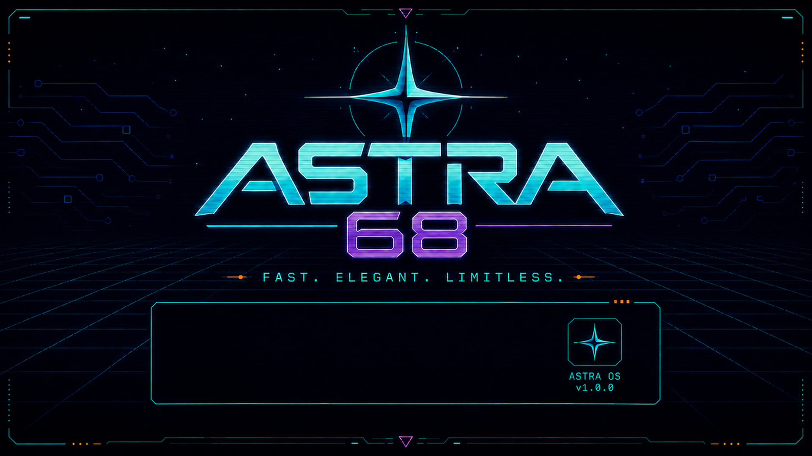
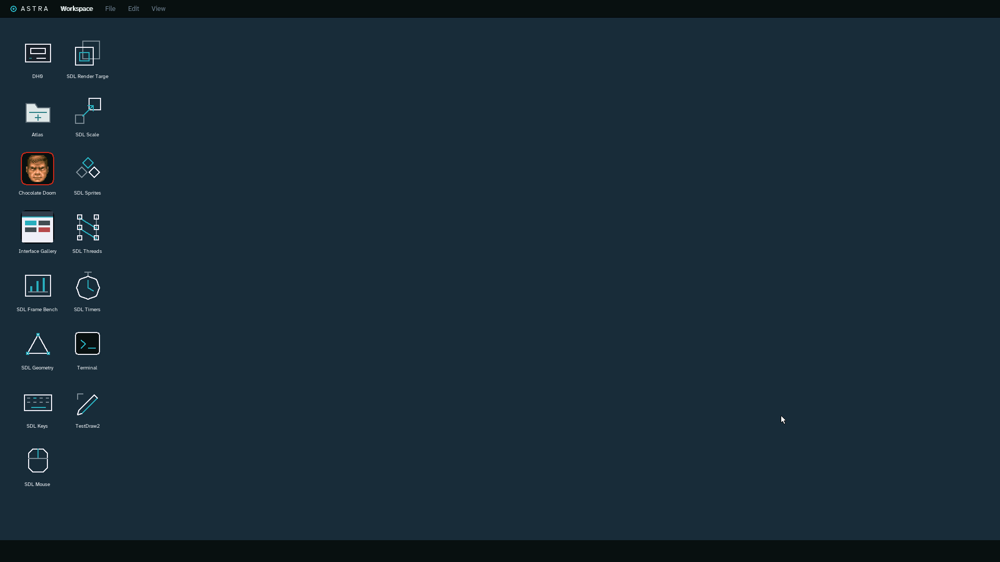
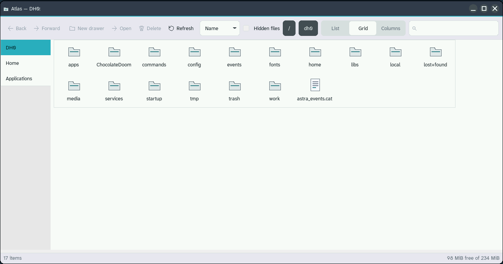
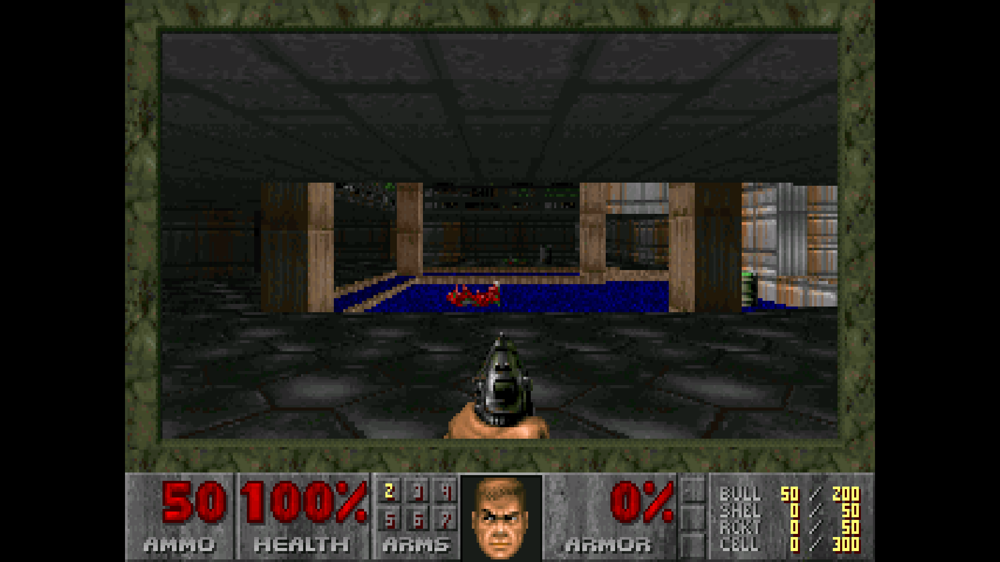

<p align="center">
  
</p>

<h1 align="center">Astra 68</h1>

<p align="center">
  <strong>A modern fantasy MC68040 computer, accelerated graphics platform,
  and operating system built from first principles.</strong>
</p>

<p align="center">
  
  
  
  
</p>

Astra 68 keeps the directness and personality of classic 68k machines while
applying what operating-system and hardware designers have learned since.
It is not an Amiga clone. It is a new big-endian machine with a protected,
preemptive kernel; a consistent service and device model; and custom FPGA
graphics designed for games and a fast graphical desktop.

The platform is **Astra 68**, the kernel is **Axiom**, and the user-facing
system is **Astra OS**.

> [!IMPORTANT]
> Astra 68 is an active engineering project, not a finished computer or a
> production-ready operating system. The repository distinguishes implemented
> behavior, simulation evidence, routed FPGA checkpoints, and hardware
> qualification. Start with [the current engineering state](docs/CURRENT_STATE.md).

## What works today

- Axiom reaches its K1-K10 protected-kernel milestones with the MC68040 MMU,
  process and thread separation, preemptive scheduling, bounded IPC and waits,
  handles and rights, shared areas, fault containment, memory pressure
  handling, device infrastructure, tracing, panic output, and performance
  gates.
- The DE25 has separate 1 GiB LPDDR4 banks for the HPS and graphics. Astra uses
  512 MiB of guest RAM; graphics and sound use 512 MiB of the separate media bank.
- The hardware-qualified 1920x1080p60 graphics path includes RGB565/XRGB8888/
  INDEX8 framebuffers, two independently scrolling tile layers, 64 INDEX8
  sprites up to 128x128, sixteen per-sprite palette banks, alpha and opacity,
  scaling, signed off-screen positioning, clipping, collision reporting, and
  atomic frame-boundary scene promotion.
- The routed DE25 renderer drives a windowed desktop with hardware fills,
  copies, compositing, glyphs, geometry, sprites and raster effects. Exact
  timing and hardware checkpoints live in
  [the DE25 timing record](fpga/de25/TIMING_CLOSURE.md).
- Native applications and SDL2 ports share the same desktop, input, audio,
  process and filesystem facilities. Terminal brings a real zsh shell;
  Chocolate Doom brings something worth playing.
- Double-clicking the mounted DH0 desktop volume opens native Atlas with its
  actual root entries as file/folder icons. The initial viewer supports
  scrolling and resize; navigation and live removable volumes are next.
- Right-click DH0 or an application icon for its native Open menu. Desktop
  context menus and ASTRA share the common menu control, with keyboard
  navigation, checked/disabled rows and scrolling. See the
  [physical context-menu capture](docs/images/astra-context-menu.png).
- The native filesystem supports ext4, RAMFS and confined HostFS volumes,
  with shared file descriptions, links, atomic bounded writes and recovery.
  Current correctness gates pass; performance acceptance remains open.
- The Astra QEMU backend runs on the active DE25 and is the only emulator.

The current desktop uses crisp instrument icons in Astra's white and cyan
palette. This desktop and the Atlas window below were captured from the
physical DE25 on October 12, 2026, through its authenticated remote desktop
service. Capture identities and validation are in [the image record](docs/images/README.md).



Atlas opens the mounted DH0 volume through the native filesystem and launcher.



Chocolate Doom runs on the same native graphics, input, audio and filesystem
facilities. Yes, this machine plays Doom. This gameplay frame was captured on
October 11, 2026.



Even Doom knows where it lives: [quit to Astra](docs/images/astra-doom-quit.png).

## Direction

Astra OS is intended to be a compact, responsive graphical system with a
powerful shell and a uniform, extensible object and service model. Filesystems,
graphics policy, desktop, input policy, format handlers, audio mixing, and
other services live outside the kernel. Hot paths use shared areas, bounded
rings, coarse messages, and hardware acceleration rather than chatty RPC.

The graphics architecture ultimately includes:

- framebuffer and tile scrolling with tear-free frame transactions;
- 64 hardware sprites plus blitter-backed virtual sprites;
- copper-controlled raster effects;
- copy, compositing, ROP, geometry, pattern, and flood engines;
- hardware AFNT glyph expansion;
- wave-synthesis and PCM audio engines;
- fixed-point and game-oriented math acceleration.

The detailed contract is in
[GRAPHICS_ARCHITECTURE.md](docs/GRAPHICS_ARCHITECTURE.md). Features listed
there are architectural commitments, not all completed hardware.

## Architecture

```text
Astra applications and system services
                 |
       stable Astra NDK / service ABIs
                 |
          Axiom protected kernel
                 |
         MC68040 + MMU environment
                 |
     bounded MMIO and shared command rings
                 |
   FPGA display, sprites, tiles, and render engines
```

The active machine runs the MC68040/MMU environment in QEMU TCG on the
DE25-Nano HPS and uses the FPGA fabric for graphics and peripherals. QEMU is
the only CPU implementation in this repository.

## Repository map

| Path | Contents |
|---|---|
| [`docs/`](docs/) | Architecture, ABI, status, budgets, and measured timing records |
| [`sw/kernel/`](sw/kernel/) | Axiom MC68040 kernel and host-side state-machine tests |
| [`sw/boot/`](sw/boot/) | Boot ROM, splash assets, loaders, and boot contracts |
| [`ndk/`](ndk/) | Public Astra developer interfaces and generated documentation |
| [`fpga/de25/`](fpga/de25/) | Active Agilex/DE25 hardware and Linux integration |
| [`fpga/arty/`](fpga/arty/) | Retained rollback-platform integration and graphics sources |
| [`emu/qemu/`](emu/qemu/) | The Astra QEMU machine backend |
| [`third_party/`](third_party/) | Vendored upstream components with their original notices |

## Build and test

Different parts of Astra 68 have different toolchain requirements. Useful
host-side entry points are:

```sh
# Axiom host tests
make -C sw/kernel test

# Emulator for the host, the desktop, or the DE25 board
emu/qemu/build.sh host

# Directed active-graphics RTL suite (requires Icarus Verilog)
fpga/arty/graphics/run_tests.sh
```

Building the target kernel and ROM uses the project's `m68k-astra` toolchain.
Production FPGA builds use Quartus Pro on Beast; Vivado builds serve the Arty
rollback platform. Exact lab build,
route, deployment, and rollback procedures are intentionally kept in the
component documentation because a reduced or unconstrained bitstream is not
release evidence.

See [the inventory](docs/INVENTORY.md) for the machines, boards and toolchains
and [Arty graphics](fpga/arty/graphics/README.md) for focused setup.

## Engineering rules

- Motorola MC68040 behavior is authoritative; implementation shortcuts do not
  define a new CPU dialect.
- Bounded latency, predictable memory use, failure isolation, and measurable
  performance take priority over feature count.
- Simulation success is necessary but not sufficient. FPGA features require
  constrained timing closure and physical hardware evidence.
- Performance and resource use are measured continuously before higher layers
  depend on them.
- Public ABI structures are fixed-width, big-endian, versioned, and independent
  of compiler-private C layouts.

## Documentation

- [Current engineering state](docs/CURRENT_STATE.md)
- [Kernel architecture](docs/KERNEL_ARCHITECTURE.md)
- [Memory map and PMMU](docs/MEMORY_MAP_AND_PMMU.md)
- [System ABI](docs/ABI.md)
- [Graphics architecture](docs/GRAPHICS_ARCHITECTURE.md)
- [Astra OS vision](docs/OS_VISION.md)
- [Arty graphics timing closure](fpga/arty/graphics/TIMING_CLOSURE.md)
- [Build and test artifact policy](docs/ARTIFACT_POLICY.md)

## Licensing

No single project-wide license currently covers every Astra-authored file.
Third-party components retain the licenses and notices shipped in their
directories and source headers. Public visibility does not replace those
terms or grant additional rights; review the applicable component before
redistributing or incorporating code.
