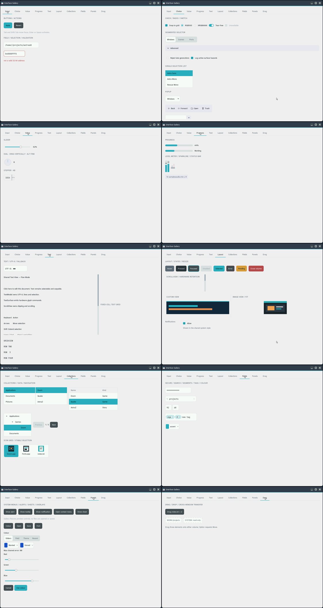

# Interface Gallery previews

Captured from Interface Gallery running on the DE25-Nano. Each image shows the
selected tab in the native Astra window. The Choice and Layout previews start
at the top of their scrollable pages; more examples appear below.

| Tab | Full-size preview |
| --- | --- |
| Input | [Input](media/interface-gallery/gallery-preview-input.png) |
| Choice | [Choice](media/interface-gallery/gallery-preview-choice.png) |
| Value | [Value](media/interface-gallery/gallery-preview-value.png) |
| Progress | [Progress](media/interface-gallery/gallery-preview-progress.png) |
| Text | [Text](media/interface-gallery/gallery-preview-text.png) |
| Layout | [Layout](media/interface-gallery/gallery-preview-layout.png) |
| Collections | [Collections](media/interface-gallery/gallery-preview-collections.png) |
| Fields | [Fields](media/interface-gallery/gallery-preview-fields.png) |
| Panels | [Panels](media/interface-gallery/gallery-preview-panels.png) |
| Drag | [Drag](media/interface-gallery/gallery-preview-drag.png) |

Raw 1920×1080 RFB frames, PNG window crops, and verified checksums are archived
on Beast at `/mnt/Documents/astra68/interface-gallery-previews-20261029/`.
